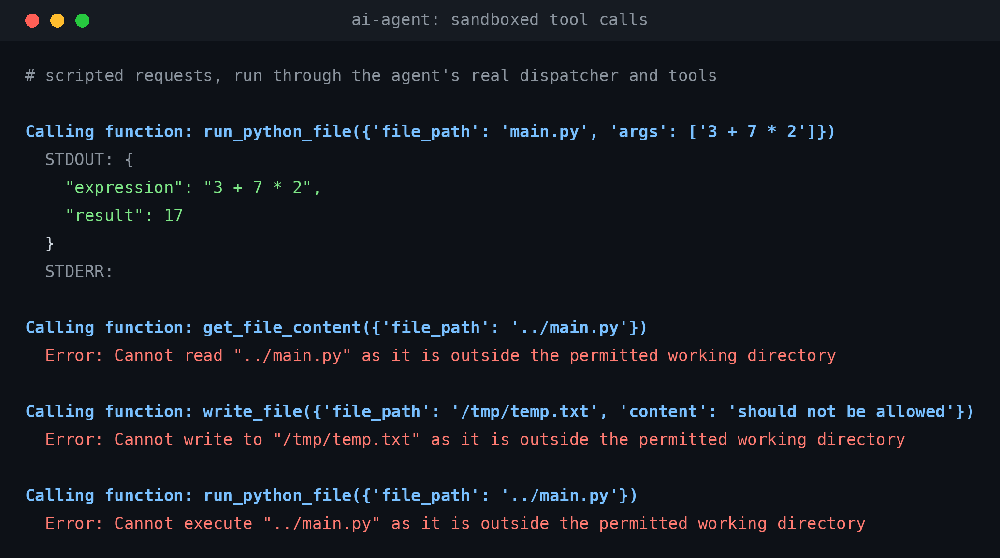

## AI Agent

**A terminal coding agent built on Gemini 2.5 Flash: give it a task in plain English and it lists, reads, writes, and runs Python files inside a sandboxed directory until it can answer.**
 
```bash
uv run main.py "run the calculator on '3 + 7 * 2'"
```
 

 
*Scripted requests run through the agent's real dispatcher and tools: one allowed call, then three rejected escapes. A script stands in for the model here.*
 
## Motivation
 
A coding agent sounds like a framework. It is really a loop and a handful of tools: send the conversation to the model, run whatever functions it asks for, append the results, repeat until it answers in plain text.
 
Wrenchbot is that loop with nothing hidden: no agent framework, four tools, about 350 lines of Python. It exists to show exactly how an agent decides, acts, and recovers, and to take the dangerous part seriously. Letting a model write and run code is the point, so the working directory is hardcoded outside the model's control and every path is checked before a tool touches the disk.
 
## Quick Start
 
Requires **Python 3.13+**, [uv](https://docs.astral.sh/uv/), and a Gemini API key from [Google AI Studio](https://aistudio.google.com/apikey).
 
```bash
git clone https://github.com/amayakmt/ai-agent.git
cd ai-agent
uv sync
echo 'GEMINI_API_KEY=your_key_here' > .env
uv run main.py "run the calculator on '3 + 7 * 2'"
```
 
Run commands from the repository root. The agent works inside `./calculator`, a small expression evaluator with its own tests, and for this prompt it should run `calculator/main.py`, which prints a JSON result of `17`.
 
Read [Security](#security) before you change the working directory or point the agent at your own code.
 
## Usage
 
```bash
uv run main.py "what files are in the calculator package?"
uv run main.py "explain what calculator/pkg/calculator.py does"
uv run main.py "run the tests and tell me if anything fails"
uv run main.py "run the calculator on '3 + 7 * 2'" --verbose
```
 
Each tool call prints as ` - Calling function: <name>`, and the model's final answer prints last. With `--verbose`, a run also shows your prompt, the arguments of every call, the raw tool results, and prompt and response token counts per turn.
 
### How a run works
 
1. Your prompt becomes the first message in the conversation history.
2. Each turn, the history and the tool catalog go to Gemini with a system prompt and temperature 0.
3. If the model replies with function calls, each one runs and its result is appended to the history, then the next turn starts.
4. If the model replies with text only, that text is printed and the program exits.
5. After 20 turns without a final answer, the program prints an error and exits with code `1`.
### Tools
 
| Tool | What it does |
| --- | --- |
| `get_files_info` | Lists a directory with file sizes and whether each entry is a directory |
| `get_file_content` | Reads a file, truncated at 10,000 characters with a notice |
| `write_file` | Creates or overwrites a file and creates missing parent directories |
| `run_python_file` | Runs a `.py` file with optional arguments and a 30-second timeout, returning stdout, stderr, and any non-zero exit code |
 
### What the sandbox rejects
 
Every tool receives its working directory from `call_function.py`, never from the model, and resolves each requested path against it. These results come from the real tool functions:
 
```text
get_files_info("calculator", "../")
Error: Cannot list "../" as it is outside the permitted working directory
 
get_file_content("calculator", "/bin/cat")
Error: Cannot read "/bin/cat" as it is outside the permitted working directory
 
write_file("calculator", "/tmp/temp.txt", ...)
Error: Cannot write to "/tmp/temp.txt" as it is outside the permitted working directory
 
run_python_file("calculator", "../main.py")
Error: Cannot execute "../main.py" as it is outside the permitted working directory
 
run_python_file("calculator", "lorem.txt")
Error: "lorem.txt" is not a Python file
```
 
### Configuration
 
| Setting | Default | Where |
| --- | --- | --- |
| `MAX_CHARS` | 10000 | `config.py`: characters returned by `get_file_content` |
| `MAX_ITERS` | 20 | `config.py`: turns before the agent gives up |
| Model | `gemini-2.5-flash` | `agent.py` |
| Temperature | 0 | `agent.py` |
| System prompt | | `prompts.py` |
| Working directory | `./calculator` | `call_function.py` |
 
The agent has no memory between runs, no streaming, and no confirmation step before it writes or runs anything.
 
## Security
 
This program gives a language model the ability to read, overwrite, and execute files on your machine. Treat it that way.
 
- **The working directory is the boundary.** It is set by one line in `call_function.py`: `args["working_directory"] = "./calculator"`. Point it at `.`, `~`, or `/` and the agent can reach everything under that path. Use a disposable, low-value directory.
- **Path checks are lexical.** They block `..`, absolute paths, and sibling directories that share a prefix. They do not resolve symlinks, so a symlink inside the working directory that points elsewhere will be followed.
- **`run_python_file` runs arbitrary Python** with your user's permissions, including files the model just wrote. The path checks cover where the script lives, not what it does, and the 30-second timeout limits runaway scripts, not damage. The script also runs with the repository root as its working directory. Run the agent in a container, VM, or unprivileged account if the machine holds anything you care about.
- **`write_file` overwrites silently.** There is no diff, backup, or prompt. Commit before you run the agent.
- **Keep your key out of git.** `GEMINI_API_KEY` lives in `.env`, which is git-ignored. `--verbose` prints tool arguments and raw results, so a file with secrets in it can end up in your terminal history or logs.
- **Prompt injection applies.** File contents go back to the model as context. A file that says "ignore your instructions" can steer it. Do not run the agent over directories you do not trust.
## Contributing
 
### Clone the repo
 
```bash
git clone https://github.com/amayakmt/ai-agent.git
cd ai-agent
```
 
### Install dependencies and add a key
 
```bash
uv sync
echo 'GEMINI_API_KEY=your_key_here' > .env
```
 
### Check the tools without calling the model
 
The `test_*.py` files at the root are manual scripts that print results for inspection. They do not assert, and they need no API key.
 
```bash
uv run test_get_files_info.py
uv run test_get_file_content.py
uv run test_write_file.py
uv run test_run_python_file.py
```
 
`test_write_file.py` overwrites `calculator/lorem.txt` and `calculator/pkg/morelorem.txt`, so run `git checkout calculator/` afterward.
 
### Run the calculator's own tests
 
```bash
cd calculator && python tests.py
```
 
### Project layout
 
```text
main.py               # Entry point: argument parsing, env loading, the agent loop
agent.py              # One turn: call Gemini, run the function calls it returns
call_function.py      # Tool catalog, dispatch, and the hardcoded working directory
config.py             # MAX_CHARS and MAX_ITERS
prompts.py            # System prompt
functions/            # The four tools and their schemas
calculator/           # The sandboxed project the agent works on
test_*.py             # Manual tool checks
```
 
### Submit a pull request
 
Fork the repository and open a pull request to `main` with a focused change.
 
## License
 
[MIT](LICENSE)